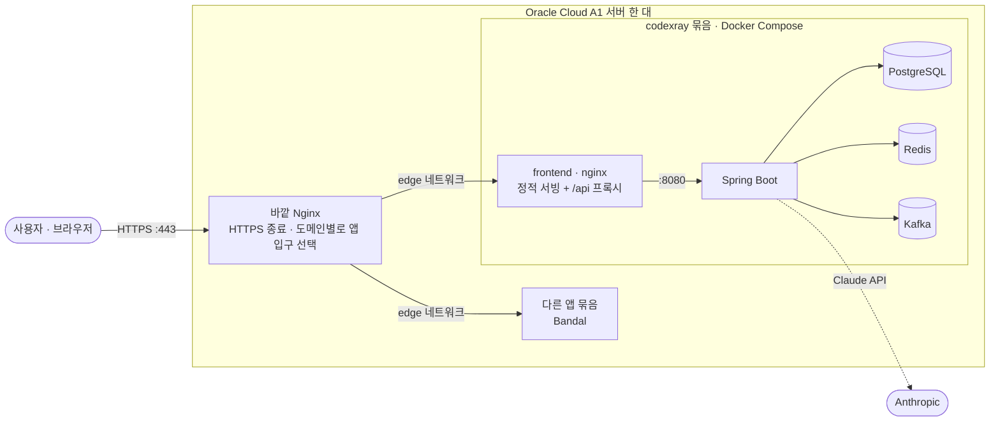
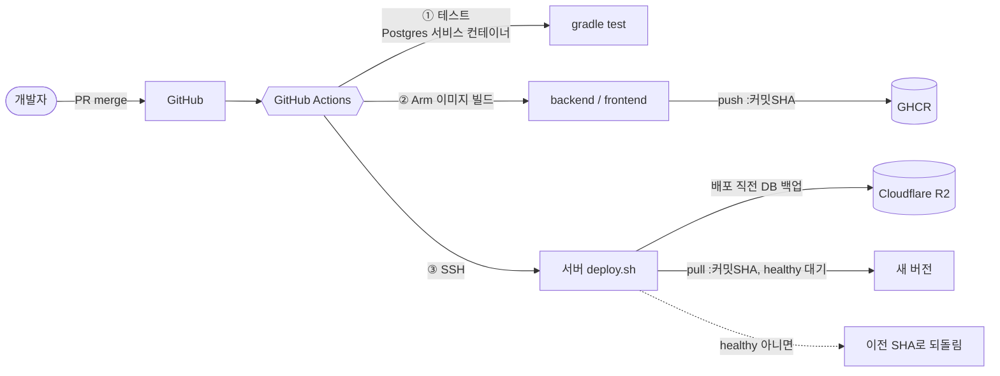

<!-- 성능 수치의 정본은 00_핵심요약.md 3-1입니다. 서류에 인용하기 전에 3-1과 대조하세요.
     이 파일의 "최초 측정" 표는 철회됐습니다(2026.09). -->

# codeXray

> 알고리즘 문제풀이 기록과 **AI 코드 분석**을 한곳에서 — 내 풀이를 X-ray 하듯 들여다보는 학습 플랫폼

codeXray는 알고리즘 문제를 풀고, 풀이·메모·노트를 남기고, **Claude 기반 AI로 내 코드를 분석/힌트**받으며, 커뮤니티에서 함께 성장하는 서비스입니다. 웹과 **브라우저 확장** 두 클라이언트를 지원하며, GitHub Actions → GHCR → 오라클 클라우드 Arm 서버로 이어지는 **CI/CD 파이프라인 위에서 컨테이너로 배포**됩니다. 서비스 주소: **https://codexray.org**

---

## 📚 목차
- [주요 기능](#-주요-기능)
- [기술 스택](#-기술-스택)
- [시스템 아키텍처](#-시스템-아키텍처)
- [CI/CD & 배포](#-cicd--배포)
- [성능 최적화](#-성능-최적화)
  - [성능 재측정 (2026-08-12)](#성능-재측정-2026-08-12)
- [기술적 의사결정](#-기술적-의사결정)
- [로컬 실행](#-로컬-실행)
- [프로젝트 구조](#-프로젝트-구조)

---

## ✨ 주요 기능

| 도메인 | 내용 |
|---|---|
| **인증** | 이메일 회원가입·인증메일, 로그인/로그아웃, JWT(access) + refresh 토큰 **회전(rotation)**, 소셜 로그인(Google/Naver) |
| **계정** | 닉네임·비밀번호 변경(소셜 계정은 비밀번호 없음), 탈퇴 — 개인 데이터는 DB `ON DELETE CASCADE`로 즉시 삭제, 글·댓글은 작성자만 비움. [개인정보처리방침](https://codexray.org/privacy) |
| **문제** | 문제 목록(태그·난이도·출처 필터, 페이징), 상세 조회 — QueryDSL 동적 쿼리 |
| **풀이/기록** | 풀이 제출·조회, 풀이별 메모, 개인 노트 |
| **AI 분석** | 풀이 코드 분석 & 문제 힌트를 **Claude로 생성** — Kafka 비동기 처리 + 잡 폴링, 사용자별 일일 사용량 제한 |
| **커뮤니티** | 게시글·댓글·추천(투표)·신고 |
| **알림** | 활동 기반 알림 |
| **대시보드** | 개인 학습 통계, 문제 추천 |
| **체감 난이도** | 사용자 피드백 기반 난이도 보정 |
| **운영** | 관리자용 스케줄러/배치 잡 |

멀티 클라이언트: **웹**은 refresh 토큰을 httpOnly 쿠키로, **브라우저 확장**은 쿠키를 못 쓰므로 헤더/바디로 토큰을 주고받도록 인증 계층을 분기 처리했습니다.

---

## 🛠 기술 스택

**Backend**
- Java 21, Spring Boot 4.1
- Spring Security + JWT(jjwt), Spring Data JPA(Hibernate), QueryDSL
- PostgreSQL, Redis(refresh 토큰 저장소 + Spring Cache 조회 캐시), Apache Kafka(AI 비동기)
- QueryDSL 동적 쿼리, `@BatchSize` N+1 최적화
- Flyway(마이그레이션 + 시드), Spring Mail(이메일 인증)
- Anthropic Java SDK(Claude)

**Frontend**
- React 19, TypeScript, Vite 6
- TailwindCSS 4, React Router 7, TanStack Query, Zustand, Axios
- CodeMirror(다국어 코드 에디터: C++/Java/Python/JS/Go/Rust/SQL), react-markdown(AI 결과 렌더링)

**Infra / DevOps**
- Docker(멀티 스테이지 빌드, x86 러너에서 Arm 이미지), Docker Compose, nginx(정적 서빙 + 리버스 프록시)
- GitHub Actions(CI/CD), GHCR(이미지 레지스트리), SSH 배포 + 자동 되돌리기
- Oracle Cloud Ampere A1(Arm) 서버 한 대, Let's Encrypt HTTPS, Cloudflare R2(DB 백업)
- (이전) AWS EC2 ×2 — 애플리케이션 계층 / 데이터 계층 분리, Watchtower 자동배포

---

## 🏗 시스템 아키텍처

오라클 클라우드 Arm 서버 한 대에서 Docker Compose 묶음(`/srv/codexray`)으로 돕니다. 같은 서버에 다른 앱(Bandal)이 자기 묶음으로 함께 살고, HTTPS를 푸는 **바깥 Nginx**만 같이 씁니다. 서버가 밖으로 여는 포트는 80, 443뿐입니다.



- **same-origin 구조**: nginx가 React 정적파일을 서빙하고 `/api` 요청만 백엔드로 프록시 → 프론트·백엔드가 동일 오리진이라 **CORS가 불필요**하고 쿠키 인증이 단순해집니다.
- **네트워크로 격리**: 바깥 Nginx와 같은 `edge` 네트워크에 붙는 건 입구(frontend) 하나뿐입니다. backend와 PG/Redis/Kafka는 `ports`가 없어 인터넷에서도, 바깥 Nginx에서도 닿지 않습니다. 저장소는 앱마다 따로 두어 한 앱의 장애나 실수(디스크, 잘못된 마이그레이션, Redis 비우기)가 다른 앱으로 번지지 않습니다.
- **메모리 상한**: 컨테이너마다 `mem_limit`을 두고(JVM은 그 75%, Kafka 힙 512MB) 한 앱이 메모리를 다 먹어도 다른 앱이 살게 했습니다.
- **AI 비동기**: 느린 LLM 호출을 요청-응답 흐름에서 떼어내 Kafka로 처리 → 사용자는 즉시 잡 ID를 받고 결과를 폴링.

---

## 🚀 CI/CD & 배포

`master`에 merge 한 번이면 **테스트 → Arm 이미지 빌드 → 레지스트리 푸시 → 서버 배포(실패하면 자동 되돌림)** 까지 자동으로 실행됩니다.



**① CI — 빌드 & 테스트** (`.github/workflows/ci.yml`)
- push/PR마다 `./gradlew test` 실행. 테스트 28개 중 3개(전체 컨텍스트 부팅 1 · JPA 슬라이스 2 — 목록 쿼리 수, 탈퇴 시 AI 기록 삭제)가 실제 Postgres를, 3개(refresh 토큰 저장소)가 실제 Redis를 요구하므로 **Postgres 16 · Redis 7 서비스 컨테이너**를 띄우고 `DB_URL` 등 필요한 환경변수를 주입합니다. MockMvc는 컨트롤러 하나를 따로 띄워 오류 응답 코드(400/404/500)를 확인하는 데만 쓰고, 여러 계층을 관통하는 시나리오 테스트(`@WebMvcTest` · `RANDOM_PORT`)는 없습니다.
- 같은 때 프론트는 `npm run lint`(ESLint)와 `npm run build`(타입 검사 + 빌드)를 돌립니다. 둘 중 하나라도 실패하면 이미지 빌드로 넘어가지 않습니다.

**② 이미지 빌드 & 푸시**
- 테스트 통과 시에만(`needs`) backend·frontend 이미지를 **멀티 스테이지**로 빌드해 GHCR에 **커밋 SHA 태그**로 푸시합니다.
- 서버가 Arm이라 `linux/arm64` 이미지를 만듭니다. Gradle·npm 빌드 단계는 `--platform=$BUILDPLATFORM`으로 **러너의 x86 CPU에서** 돌리고(결과물 jar·정적파일은 CPU와 무관), Arm 흉내(QEMU)는 마지막 실행 단계만 탑니다. 흉내 속에서 Gradle을 돌리면 몇 배 느려집니다.
- 소셜 로그인 Client ID(공개값)는 Vite가 번들에 넣는 값이라 이미지 빌드 때 `build-args`로 주입합니다. secret은 백엔드에만 있습니다.
  - 값을 두는 곳: Client ID는 저장소 **Variables**(`GOOGLE_CLIENT_ID`, `NAVER_CLIENT_ID`. 빌드 job이 환경 밖에서 읽음), secret은 `production` 환경 **Secrets**(`GOOGLE_CLIENT_SECRET`, `NAVER_CLIENT_SECRET`).
  - 콘솔에 등록하는 콜백 주소: `https://codexray.org/oauth/callback/google`, `https://codexray.org/oauth/callback/naver` (로컬 개발용 `http://localhost:5173/...`도 같은 앱에 함께 등록).
  - Google 앱을 외부 공개(프로덕션)로 게시하려면 홈페이지와 개인정보처리방침 주소가 필요해 `/privacy` 화면을 둡니다. 네이버는 검수 전 "개발 중" 상태에서 앱 관리자와 멤버로 등록한 아이디만 로그인됩니다.
  - 값을 바꾼 뒤에는 코드 변경이 없어도 워크플로를 다시 돌려야(Re-run) 화면 이미지와 서버 `.env`에 반영됩니다.

**③ 배포 — SSH + 자동 되돌리기** (`deploy/deploy.sh`)
- GitHub Actions가 SSH로 서버에 들어가 compose 파일·스크립트·`.env`(GitHub Secrets에서 만들어 600 권한으로)를 올리고 `deploy.sh <커밋SHA>`를 실행합니다.
- `deploy.sh`는 **배포 직전 DB를 백업**(빈 Postgres에 복구해 행 수를 비교한 뒤 R2에 업로드)하고, 새 SHA로 띄운 뒤 모든 컨테이너가 healthy가 되길 기다립니다. 안 되면 **마지막으로 성공한 SHA로 되돌리고** 워크플로를 실패로 끝냅니다.
- 배포용 SSH는 키로만 열리고(비밀번호 로그인 차단) 배포 전용 사용자(sudo 없음)로 들어갑니다. 처음 보는 서버에는 접속하지 않도록 호스트 키를 Secrets에 고정해 둡니다.
- 매일 새벽 DB 백업도 같은 스크립트(`deploy/backup.sh`)로 cron이 돌리고, 성공 신호가 끊기면 healthchecks.io가 메일을 보냅니다.

> **AWS EC2 2대 → 오라클 서버 1대로 옮긴 이유 (2026-10)**
> 처음에는 AWS EC2 두 대(애플리케이션 / 데이터 계층)에 배포하고 Watchtower로 자동배포했습니다. SSH를 운영자 IP로 잠근 보안그룹에서 IP가 매번 바뀌는 GitHub Actions 러너가 들어오려면 22번을 열어야 해서, 서버가 스스로 `:latest`를 확인해 교체하는 pull 방식을 골랐습니다.
> EC2는 잠깐 띄워 확인한 뒤 내렸고, 계속 띄워 둘 곳으로 이미 운영 중이던 오라클 Arm 서버(다른 앱과 공유)를 골라 옮겼습니다. 옮기면서 배포를 SSH 방식으로 바꿨습니다.
> - 이 서버는 SSH를 **키 전용**으로만 열어 IP 제한 없이도 러너가 들어올 수 있습니다.
> - Watchtower는 Docker 소켓(=서버 root 권한)을 쥐어야 해서, 다른 앱과 같이 쓰는 서버에서는 위험이 큽니다.
> - `:latest`는 지금 무엇이 떠 있는지 알 수 없고 되돌릴 기준도 없습니다. **SHA 태그 + 되돌리기 + 배포 전 백업**이 실제 운영에서 더 중요했습니다.
> - 계층 분리(EC2 2대)는 서버 한 대 안에서 **Docker 네트워크 격리**(DB·Redis·Kafka에 포트 없음)로 대신했습니다.

---

## ⚡ 성능 최적화

문제 목록 조회를 **① 쿼리 최적화 → ② 캐싱** 2단계로 개선하고, 각 단계를 부하 테스트로 나눠 측정했습니다.

**문제 — N+1 쿼리**
목록 응답은 각 문제의 태그를 매핑하는데, `ProblemTag → AlgorithmTag` 연관이 지연 로딩이라 **태그를 하나씩 개별 조회**했습니다. 한 페이지(50문제)에 `select … from algorithm_tags where id=?` 가 태그 종류 수만큼 개별 발생 (실측 17회, 이 테이블이 25행이므로 원리상 25회가 상한).

**① 근본 해결 — `@BatchSize`**
`AlgorithmTag`에 `@BatchSize(100)`를 적용해 개별 조회를 **`id = ANY(?)` 배치 조회 2회로** 축소(SQL 로그로 확인). **캐시 없이도 N+1이 사라집니다.**

**② 반복 조회 캐싱 — Redis `@Cacheable`**
자주 읽고 거의 안 바뀌는 목록/상세·태그를 Redis에 캐싱해, 반복 요청은 DB 조회 자체를 생략.

**부하 테스트(k6) 결과 — 2026-07 최초 측정**
> ⚠️ **아래 표는 2026-07 최초 측정이며, 2026-08-12 재측정으로 대체됐습니다.
> 대표 배수는 9.5배가 아니라 8.6배입니다.** 유효한 결과는 아래
> 「성능 재측정 (2026-08-12)」 절의 표이고, 두 측정의 차이는 그 절 안의
> 「2026-07 측정과의 비교」에 있습니다. 아래 표의 값을 이력서·포트폴리오에
> 인용하지 마세요.

> 조건: 로컬 단일 머신, k6 컨테이너(`--network host`), 50 VU · think-time 0(포화) · 30초. 데이터 689문제 / 858 문제-태그 / 25 태그.

| 단계 | 처리량 | p95 | 원본 대비 |
|---|---|---|---|
| ① 원본 (N+1) | 1,662 req/s | 51.9 ms | 1.0× |
| ② `@BatchSize` (캐시 X) | 3,380 req/s | 29.2 ms | **2.0×** |
| ③ `@BatchSize` + 캐시 | 15,838 req/s | 5.8 ms | **9.5×** |

→ **쿼리 최적화만으로 2.0배**, 여기에 **캐시를 얹어 추가 4.7배(누적 9.5배)**. 캐시 미스(재시작·evict·TTL 만료) 상황에서도 ②단계 최적화가 남아 **원본으로 회귀하지 않는 것**이 핵심. — 이 수치는 대체됐습니다. 재측정 기준 누적 배수는 8.6배입니다.

> ⚠️ **이 측정의 한계** — 당시 사용한 **부하 스크립트를 보존하지 않았고, 측정 머신 사양·JVM 옵션·SQL 로깅 설정도 기록하지 않았습니다.** 따라서 위 수치는 그대로 재현할 수 없습니다. 이 문제를 인지하고 2026-08-12에 조건을 전부 기록한 재측정을 수행했습니다(아래).

---

### 성능 재측정 (2026-08-12)

위 2026-07 측정이 재현 불가능하다는 점을 보완하기 위해, **부하 스크립트를 저장소에 포함**(`perf/problems-load.js`)하고 머신 사양·측정 프로토콜을 전부 기록해 다시 측정했습니다.

**측정 환경**

| 항목 | 값 |
|---|---|
| 측정 일자 | 2026-08-12 |
| CPU | AMD Ryzen 5 7500F (6코어 / 12스레드) |
| RAM | 15 GiB (WSL2 할당분) |
| OS | Ubuntu 22.04 on WSL2 / Windows 11 |
| DB / 캐시 | PostgreSQL 16, Redis 7 (로컬 Docker 컨테이너) |
| 부하 도구 | `grafana/k6:latest` 컨테이너 (`--network host`) |
| 스크립트 | [`perf/problems-load.js`](perf/problems-load.js) |

**부하 조건**

- **동시성** 50 VU · **think-time** 0 (포화 부하) · **지속 시간** 30초
- **대상** `GET /api/problems` (page 0, size 50, sort=createdAt desc, 필터 없음)
- **워밍업** 상태마다 30초 1회 실행 후 결과 폐기 → 이어서 **본 측정 2회**
- **앱 기동** 상태 전환마다 JVM 완전 재시작
- **캐시 초기화** 워밍업 직전 `FLUSHDB`로 `DBSIZE 0` 확인
  (③은 워밍업이 캐시를 채우므로 본 측정은 warm 상태 — 이것이 ③의 정의)
- **배경 부하 통제** Gradle 데몬 종료 + 30초 안정화 후 측정
- **SQL 로깅** 네 상태 모두 런타임 프로퍼티로 OFF
  (`--logging.level.org.hibernate.SQL=OFF --spring.jpa.show-sql=false`)

**데이터 규모** — `problems` 689 / `problem_tags` 858 / `algorithm_tags` 25 (Flyway V1~V10 시드 그대로)

**측정한 네 가지 코드 상태**

| 상태 | `@Cacheable` | `Problem.problemTags` `@BatchSize` | `AlgorithmTag` 클래스 `@BatchSize` |
|---|---|---|---|
| ① 참고 기준선 | 비활성 | **비활성** | 비활성 |
| ①′ 실제 개선 전 | 비활성 | 활성 | **비활성** |
| ② `@BatchSize` | 비활성 | 활성 | 활성 |
| ③ `@BatchSize` + 캐시 | 활성 | 활성 | 활성 |

**결과**

| 단계 | 처리량 (중앙값) | p95 | 목록 1페이지 쿼리 수 | 측정 후 `DBSIZE` | ①′ 대비 |
|---|---|---|---|---|---|
| ①′ 개선 전 | 795 req/s | 97.0 ms | **20** | 0 | 1.0× |
| ② `@BatchSize` (캐시 X) | 2,173 req/s | 39.6 ms | **4** | 0 | **2.7×** |
| ③ `@BatchSize` + 캐시 | 6,857 req/s | 11.4 ms | **4** | 1 | **8.6×** |
| *(참고) ① 두 계층 모두 배치 없음* | *397 req/s* | *157.7 ms* | *69* | *0* | *0.5×* |

모든 실행에서 HTTP 실패율 0.00%.

→ **`@BatchSize` 하나로 2.7배**, 여기에 **캐시를 얹어 추가 3.2배(누적 8.6배)**. p95는 97.0 ms → 11.4 ms로 **8.5배 단축**.

**기준선을 ①′로 잡은 이유** — 이 프로젝트에서 실제로 고친 것은 `AlgorithmTag`에 `@BatchSize`가 **없던 것 하나**입니다. `Problem.problemTags`의 배치 설정은 그 전부터 있었습니다. 두 계층을 모두 제거한 ①(쿼리 69)은 **이 코드베이스에 존재한 적 없는 상태**이므로, 그 대비 배수(17.3×)를 개선 성과로 쓰지 않고 참고용으로만 남깁니다.

**쿼리 수 내역** — ①′의 20개 = content select 1 + count select 1 + `problemTags` 배치 1 + `algorithm_tags` 개별 조회 17. `algorithm_tags`는 25행뿐이고 Hibernate 1차 캐시가 세션 내 id 중복을 제거하므로, 태그 개별 조회는 **원리상 25회를 넘을 수 없습니다.** 이 쿼리 수는 회귀 테스트(`ProblemListQueryCountTest`)로 상한 4에 고정되어 있습니다.

**측정 시 유의사항 (재현하려는 경우 반드시 확인)**

1. **SQL 로깅을 반드시 끌 것.** `show-sql: true` + `format_sql: true` + Hibernate SQL DEBUG를 켠 채로 ①을 재면 **120 / 129 req/s**가 나옵니다 — 끈 상태(382 / 364) 대비 **약 3.0배 느립니다.** ③은 캐시 적중이라 SQL이 없어 영향이 없으므로, 로깅을 켠 채 재면 개선 배수만 부풀려집니다.
2. **③은 배경 CPU 부하에 민감합니다.** ①·②는 DB·커넥션 풀이 병목이라 둔감하지만 ③은 순수 CPU/직렬화 바운드입니다. 유휴 Gradle 데몬(약 1 GB JVM)이 떠 있는 상태의 ③은 5,870 / 5,452 req/s로, 정리 후(6,900 / 6,815)보다 **20% 낮게** 나왔습니다.
3. **k6와 앱이 같은 머신에서 돕니다.** 50 VU 포화 부하 생성이 12스레드를 앱과 나눠 쓰므로, 부하 생성기를 분리하면 네 단계 모두 더 높은 절대값이 나올 수 있습니다.
4. **`spring.cache.type=none`으로는 캐시가 꺼지지 않습니다.** `CacheConfig`가 `RedisCacheManager`를 명시적 `@Bean`으로 등록해 `CacheAutoConfiguration`이 `@ConditionalOnMissingBean`으로 물러나기 때문입니다. 캐시를 끄려면 `@Cacheable`을 직접 제거해야 합니다. (측정 시 캐시 on/off는 실행 후 `DBSIZE`로 검증했습니다.)

**2026-07 측정과의 비교**

| 단계 | 2026-08 재측정 | 2026-07 최초 측정 | 절대값 비 |
|---|---|---|---|
| 개선 전 | 795 req/s / 97.0 ms | 1,662 req/s / 51.9 ms | 0.48× |
| ② `@BatchSize` | 2,173 req/s / 39.6 ms | 3,380 req/s / 29.2 ms | 0.64× |
| ③ + 캐시 | 6,857 req/s / 11.4 ms | 15,838 req/s / 5.8 ms | 0.43× |
| **누적 배수** | **8.6×** | **9.5×** | — |

절대값은 세 단계 모두 낮지만 **누적 개선 배수는 8.6× 대 9.5×로 근접**합니다. 절대값 차이는 측정 머신과 부하 생성기 배치의 차이로 보이며, 2026-07 측정의 환경이 기록되지 않아 원인을 특정할 수는 없습니다.

**실행계획(EXPLAIN) 확인**
메인 검색 쿼리를 `EXPLAIN ANALYZE`로 본 결과, 현재 규모(689행)에선 PostgreSQL이 **Seq Scan + Hash Join**을 선택(0.2~0.5ms)합니다. 이 크기에선 tier/source/created_at 인덱스를 추가해도 플래너가 쓰지 않아 이득이 없어, 실질 병목인 **라운드트립(N+1)** 을 먼저 잡았습니다. (수십만 행 규모가 되면 인덱스를 재검토.)

**무효화 전략 — 데이터 성격에 맞게 분리**
- **문제 상세**: 체감난이도 피드백으로 그 문제의 tier가 바뀔 때 **해당 키만 정밀 무효화**(`@CacheEvict(key=…)`).
- **문제 목록**: 어떤 필터·페이지 키가 영향받는지 특정 불가 → **전체 무효화(`allEntries`)** + 30분 TTL 안전망.
- **태그 목록**: 런타임에 바뀌지 않는 참조 데이터 → **TTL(1시간)만** 으로 관리.

**그 밖의 설계 포인트**
- **조건부 캐싱**: 자유 검색어(`keyword`)가 있는 요청은 키 조합이 사실상 무한해 히트율이 낮고 메모리만 잠식하므로 캐싱에서 제외하고, 반복이 잦은 browse/필터 조회만 캐싱합니다.
- 값 직렬화는 **JSON**(`GenericJackson2Json`)으로 두어 언어 중립적이고 `redis-cli`로 값 확인이 쉽습니다.

> 로컬(단일 머신·소량 데이터) 기준 수치입니다. 애플리케이션과 DB가 분리된 실제 배포에선 쿼리마다 네트워크 왕복이 더해져 N+1 제거·캐시 효과가 더 커집니다.

### 화면 첫 로딩 (2026-10-30)

운영 사이트를 느린 회선 조건으로 재 보니 첫 화면이 그려지기까지 **약 10초**가 걸렸습니다. 원인은 두 가지였습니다.

1. **압축 없이 보냄.** 화면 컨테이너의 Nginx에 gzip이 꺼져 있어 1.7MB JS를 그대로 보냈습니다(응답에 `Content-Encoding` 없음). 바깥 Nginx도 받은 그대로 넘깁니다.
2. **모든 화면을 한 파일에.** `App.tsx`가 모든 화면을 처음부터 import해서, 풀이 작성 화면에만 쓰는 코드 편집기(CodeMirror와 언어 9개)와 코드 강조(highlight.js), 마크다운까지 메인 화면에서 받았습니다.

고친 것: 화면 Nginx에서 글자 응답(JS, CSS, JSON, HTML)을 gzip으로 보내고, 메인을 뺀 화면을 `React.lazy`로 나눠 들어갈 때 받게 했습니다. 받는 동안은 레이아웃(메뉴)을 그대로 두고 본문 자리만 로딩 표시를 합니다.

> 조건: Playwright(Chromium), 캐시 없는 새 브라우저, 느린 4G 흉내(지연 150ms · 내려받기 1.6Mbps · 올리기 750kbps), CPU 4배 느리게. 화면마다 5번 재서 중앙값.
> 단계별 비교는 같은 Dockerfile로 만든 화면 이미지를 로컬에 띄워 쟀습니다(백엔드 없음, 세 경우 같은 조건). 고치기 전 로컬 값은 운영에서 잰 값(메인 FCP 9,916ms, JS 1,743KB)과 거의 같았습니다.

| 단계 | 메인 `/` 받은 JS | 메인 FCP | 메인 LCP | `/problems` 받은 JS | `/problems` LCP |
|---|---|---|---|---|---|
| 고치기 전 | 1,741 KB (1개) | 9,769 ms | 9,932 ms | 1,741 KB (1개) | 9,917 ms |
| ① gzip | 570 KB (1개) | 3,569 ms | 3,749 ms | 570 KB (1개) | 3,717 ms |
| ② gzip + 화면 나누기 | 110 KB (1개) | 1,029 ms | 1,186 ms | 120 KB (10개) | 1,514 ms |

→ **gzip만으로 FCP 2.7배**, 화면 나누기를 더해 **누적 9.5배**(9.8초 → 1.0초). 풀이 작성 화면의 편집기 묶음(약 860KB, 압축 300KB)은 그 화면에 들어갈 때만 받습니다.

**운영에서는 gzip이 안 됐다 — 로컬과 운영의 구조 차이**
배포 뒤 운영을 다시 재니 메인 FCP는 2,502ms(받은 JS 340KB)였습니다. 화면 나누기는 들어갔는데 압축이 빠진 값입니다. 응답에 `Vary: Accept-Encoding`은 붙는데 `Content-Encoding`이 없었습니다.
- 운영은 브라우저 → 바깥 Nginx → 화면 컨테이너 Nginx 순서입니다. 바깥 Nginx는 안쪽으로 **HTTP/1.0**으로 넘기고(`proxy_http_version` 기본값), Nginx gzip은 기본으로 **HTTP/1.1 요청에만** 압축합니다(`gzip_http_version 1.1`).
- 로컬 측정은 브라우저가 화면 컨테이너에 직접 HTTP/1.1로 붙어서 이 차이가 드러나지 않았습니다. 운영 컨테이너의 설정 파일을 그대로 가져와 HTTP/1.0과 1.1로 물어 보니 1.1에만 `Content-Encoding: gzip`이 붙었습니다.
- 화면 Nginx에 `gzip_http_version 1.0`을 넣었습니다. 바깥 Nginx를 고치는 방법(`proxy_http_version 1.1`)도 있지만, 앱 저장소 안에서 끝나는 쪽을 골랐습니다.
- 다시 잴 때는 앞에 기본 설정 Nginx를 하나 세워 운영과 같은 길로 쟀습니다: 압축됨, 메인 FCP 1,019ms, JS 111KB.

| 운영 | 메인 받은 JS | 메인 FCP | 메인 LCP | `/problems` LCP |
|---|---|---|---|---|
| 고치기 전 | 1,743 KB | 9,916 ms | 10,032 ms | 10,007 ms |
| 화면 나누기만(압축 빠짐) | 340 KB | 2,502 ms | 2,655 ms | 2,992 ms |

---

## 💡 기술적 의사결정

프로젝트를 진행하며 고민하고 선택한 지점들입니다.

- **JWT access + refresh 회전**
  짧은 수명의 access 토큰과, Redis에 저장되고 요청 때마다 재발급되는 refresh 토큰을 분리했습니다. refresh는 웹에선 httpOnly 쿠키로 내려 XSS 탈취 위험을 낮췄습니다.

- **비밀번호를 바꾸면 다른 기기 로그아웃**
  처음엔 refresh 토큰을 "토큰 → 사용자"로만 저장해서, 비밀번호를 바꿔도 다른 기기(확장 포함)의 로그인이 최대 14일 살아 있었습니다. 비밀번호가 새서 바꾸는 경우엔 바꾼 의미가 없습니다. 사용자별 토큰 목록(Redis Set)을 함께 두고, 비밀번호를 바꾸거나 탈퇴하면 그 목록의 토큰을 모두 지웁니다. 지금 기기에는 새 토큰을 쿠키로 다시 내려 로그인을 이어 줍니다. 이미 발급된 access 토큰은 상태 없는 JWT라 만료(30분)까지 남는데, 이를 막으려면 요청마다 블랙리스트를 조회해야 해서 받아들였습니다.

- **웹 / 브라우저 확장 동시 지원**
  쿠키를 쓸 수 없는 확장 클라이언트를 위해 `X-Client`/`X-Refresh-Token` 헤더 경로를 두어, 같은 인증 로직을 두 매체에서 재사용합니다.

- **AI 호출의 비동기화(Kafka)**
  LLM 응답은 수 초~수십 초가 걸릴 수 있어, 동기 처리 시 요청 스레드를 오래 점유합니다. 분석/힌트 요청을 이벤트로 발행하고 컨슈머가 처리하도록 하여 API는 즉시 응답하고 클라이언트는 잡 상태를 폴링합니다.

- **Flyway가 스키마를 소유, Hibernate는 검증만(`ddl-auto: validate`)**
  마이그레이션(V1~V11)으로 스키마 변경 이력을 명시적으로 관리하고, 엔티티-스키마 불일치는 부팅 시점에 잡습니다.

- **탈퇴 정리는 DB 외래키가 맡는다**
  유저 소유 테이블은 `ON DELETE CASCADE`, 다른 사람과 얽힌 글·댓글은 `ON DELETE SET NULL`로 두어 서비스 코드가 테이블을 하나하나 지우지 않습니다. 붙여넣은 코드가 담기는 `ai_jobs`에만 외래키가 빠져 탈퇴해도 남던 것을 V11에서 바로잡았습니다(`AiJobUserCascadeTest`).

- **전역 예외 처리 일원화**
  `ErrorCode` enum + `BusinessException` + `@RestControllerAdvice`로 에러 응답 형식을 통일했습니다. 숫자 자리에 글자·필수 파라미터 누락·깨진 JSON은 400, 없는 주소는 404로 돌려주고, 그 밖의 예상 못 한 예외만 500 + 서버 로그로 남깁니다(처음에는 이런 요청이 전부 로그 없는 500이었습니다).

- **성능은 캐시부터가 아니라 쿼리부터**
  캐시로 덮기 전에 N+1을 `@BatchSize`로 근본 해결하고(캐시 미스에도 유효), 그 위에 캐싱을 얹었습니다. 각 단계를 부하 테스트로 분리 측정([성능 최적화](#-성능-최적화) 참고). 읽기 캐시는 "빠르게"보다 **"정확하게 오래되지 않게"** 를 먼저 보고, 데이터가 바뀌는 지점(피드백→tier 재계산)을 찾아 캐시별 무효화 방식을 나눴습니다. 이미 refresh 토큰용으로 쓰던 Redis를 재사용해 인프라 추가는 없었습니다.

- **배포 아키텍처의 트레이드오프**
  처음 AWS에서는 비용을 이유로 ALB/사설 서브넷 없이 public 서브넷 + 보안그룹만으로 격리하고 데이터 계층을 별도 EC2로 분리했습니다. 지금은 다른 앱과 함께 쓰는 Arm 서버 한 대라, 격리를 Docker 네트워크(저장소에 포트 없음, 바깥 Nginx는 입구만 앎)와 컨테이너별 메모리 상한으로 합니다. 소규모 서버의 메모리 한계(예: Kafka 기본 힙 1GB)를 고려해 JVM·Kafka 힙을 제한하는 등 **제약 안에서의 안정화**를 진행했습니다([CI/CD & 배포](#-cicd--배포)의 이전 이유 참고).

---

## 💻 로컬 실행

**사전 준비**: JDK 21, Node 20+, Docker

**1) 데이터 인프라 기동 (Postgres / Redis / Kafka)**
```bash
cd backend
docker compose up -d   # 로컬 개발용(backend/docker-compose.yml). 포트 5432/6379/9092
```

**2) 백엔드**
```bash
cd backend
cp .env.example .env   # DB/Redis/Kafka 접속 정보, JWT_SECRET(32자 이상) 등 채우기
./gradlew bootRun
```

**3) 프론트엔드**
```bash
cd frontend
npm install
npm run dev            # Vite dev 서버 (프록시로 백엔드 연결)
```

> `.env` 파일들은 실제 비밀값을 담으므로 커밋되지 않습니다(`.env.example`만 제공).

---

## 📁 프로젝트 구조

```
codeXray/
├── backend/                 # Spring Boot (Java 21)
│   ├── src/main/java/...     # 도메인별 패키지: auth, user, problem, solution,
│   │                         #   rating, note, community, notification, stats,
│   │                         #   recommend, ai, scheduler, common, config
│   ├── src/main/resources/
│   │   ├── application.yml
│   │   └── db/migration/     # Flyway V1~V11 (스키마 + 시드)
│   └── Dockerfile
├── frontend/                # React 19 + Vite + TS
│   ├── src/
│   ├── nginx.conf           # 정적 서빙 + /api 리버스 프록시
│   └── Dockerfile
├── deploy/                  # 서버(/srv/codexray)에 올라가는 파일
│   ├── compose.yml          # frontend + backend + pg + redis + kafka 한 묶음
│   ├── deploy.sh            # SHA 태그로 띄우고, 안 되면 이전 SHA로 되돌림
│   ├── backup.sh            # 덤프 → 복구 검증 → R2 업로드 (매일 + 배포 직전)
│   ├── demo-seed.sh/.sql    # 시연 데이터(.example 계정 5개, 풀이·피드백·커뮤니티·건의사항). 몇 번 돌려도 같은 모양
│   └── .env.example
└── .github/workflows/
    └── ci.yml               # CI(test) + CD(Arm 이미지 → GHCR → SSH 배포)
```
